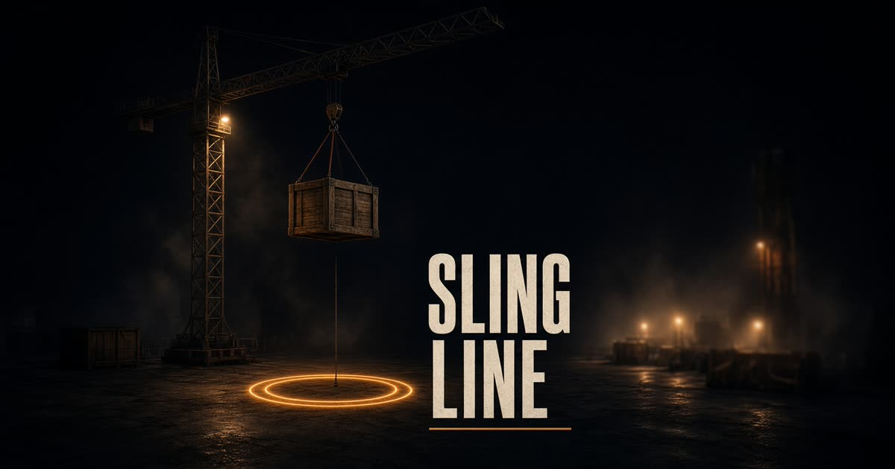

# Slingline

A tower-crane yard game about placing loads carefully. Slew the jib, move the trolley, pay out the cable, and set the crate in the amber ring. Easy mode helps settle the load; hard mode leaves the pendulum and wind alone.



## Run locally

Requires Node.js 22 or newer.

```bash
npm ci
npm run dev
```

Open the local URL printed by Vite. The game is built with TypeScript, React, Three.js, and Vite.

## How to play

Stop the crane carrier and deploy the stabilizer pads before lifting. Position the hook over the load, attach it, then move it to the amber drop ring and lower it carefully. Avoid excessive sway and follow the on-screen prompts.

Keyboard controls:

- **A / D** or **Left / Right**: slew the jib
- **W / S** or **Up / Down**: move the trolley
- **Q / R**: raise the hook; **E / F**: lower it
- **Z / C**: telescope the boom
- **H**: toggle between easy and hard difficulty

On touch screens, use the on-screen joystick or directional pad. Drag the yard to look around; use two fingers to zoom. The settings let you choose a control scheme and touch sensitivity.

## Project checks

```bash
npm test           # public game/career tests
npm run typecheck  # TypeScript check
npm run build      # production build
```

`npm run test:template` runs the original workspace-wide test suite. Some of those tests expect template-only files that are not included in this public repository, so they are kept separate from the public game's default test command.

The game implementation is in [`src/game`](src/game). The app entry point is in [`src/routes`](src/routes).
